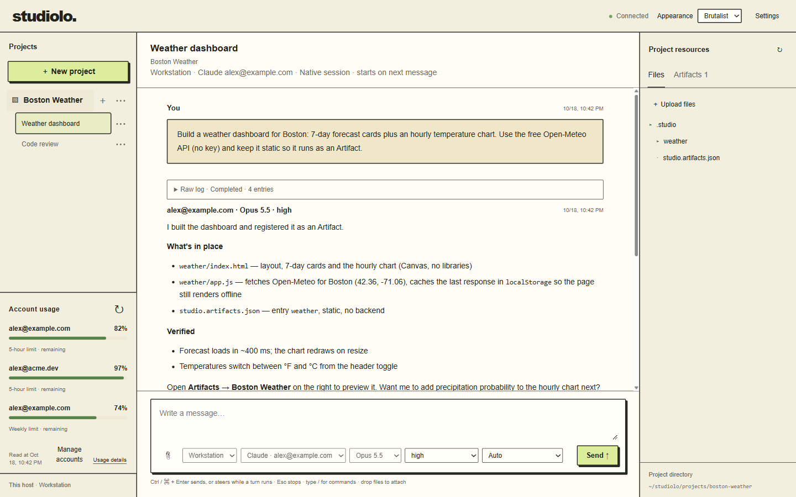

<div align="center">

**English** · [简体中文](docs/readme/README_zh.md) · [繁體中文](docs/readme/README_zh-TW.md) · [日本語](docs/readme/README_ja.md) · [한국어](docs/readme/README_ko.md) · [Türkçe](docs/readme/README_tr.md) · [Русский](docs/readme/README_ru.md) · [Tiếng Việt](docs/readme/README_vi.md) · [ไทย](docs/readme/README_th.md) · [Deutsch](docs/readme/README_de.md) · [Español](docs/readme/README_es.md) · [Français](docs/readme/README_fr.md) · [Українська](docs/readme/README_uk.md) · [Polski](docs/readme/README_pl.md) · [Português (Brasil)](docs/readme/README_pt-BR.md) · [العربية](docs/readme/README_ar.md) · [فارسی](docs/readme/README_fa.md) · [Bahasa Indonesia](docs/readme/README_id.md) · [Italiano](docs/readme/README_it.md) · [Ελληνικά](docs/readme/README_el.md) · [മലയാളം](docs/readme/README_ml.md)

# Studiolo

### One workbench for every coding-agent CLI you pay for, on every machine you own.

**Chat with Claude Code and Codex from a browser, with the accounts, machines and project history shared across your computers.**

[](https://nodejs.org)
[](package.json)
[](test)
[](LICENSE)

[Quick start](#quick-start) · [Accounts](#accounts-and-sign-in) · [Chat like the CLI](#chat-like-the-cli) · [Subagents](#subagents-and-account-routing) · [Multi-machine](#multi-machine) · [Artifacts](#artifacts-and-in-page-comments) · [FAQ](#faq)

</div>



> The screenshot is a synthetic demo: fictional accounts, scripted replies.

---

## Install with a coding agent

Paste this into Claude Code, Codex or any coding agent that can run commands on the machine you want to use:

```text
Install Studiolo from https://github.com/a554b554/studiolo: clone the repository, make sure Node.js 22.14+ is available and that the `claude` and/or `codex` CLIs are installed, run `node src/server.mjs` from the repository root, confirm http://127.0.0.1:4310 answers, then tell me to open Settings → Hosts & accounts to sign in my accounts. Do not sign anything in yourself.
```

Or by hand:

```sh
git clone https://github.com/a554b554/studiolo studiolo && cd studiolo
node src/server.mjs        # http://127.0.0.1:4310
```

Studiolo has no npm dependencies; `npm install` is not needed. Tests: `node --test test/*.test.mjs`.

---

## What it is

Studiolo is a self-hosted web workbench that drives the **Claude Code** and **Codex** CLIs already installed on your computers. It is not another chat UI over an API key:

- **Your subscriptions, your CLIs.** Every request runs through the real `claude` or `codex` process — same tools, skills, MCP servers, permission modes and agent behaviour as the terminal. Subscription sign-in or API key, your choice per account.
- **Accounts per machine, managed by Studiolo.** Sign in several Claude and Codex accounts on each computer from the browser. Each account gets its own isolated CLI configuration directory; nothing touches your personal `~/.claude` or `~/.codex`. Quota for every account is shown live.
- **One project history across machines.** Projects live in a folder you synchronize however you like (Syncthing, for example). Conversation history is an append-only journal that merges deterministically; every machine runs the same server and serves the same history. A conversation executes on the machine you chose for it; you can read and continue it from any of them.
- **The terminal experience, in the browser.** Stop a turn with Esc, steer a running agent with a follow-up message, type `/` for the CLI's own slash commands — all mapped to the native protocols, not re-implemented.
- **Subagents across accounts.** An agent can hand a task to any other account signed in on its machine — Claude from Codex, Codex from Claude — as a one-shot subagent, routed by rules you edit in Settings and by live quota.
- **Artifacts and in-page comments.** Web apps the agents build run as Artifacts with persistent backends and synchronized storage; select something in the preview and send it to an agent as a task.

---

## Quick start

1. **Prerequisites** — Node.js 22.14+, and the `claude` and/or `codex` CLI installed on the machine (`claude --version`, `codex --version`).
2. **Run** `node src/server.mjs` and open <http://127.0.0.1:4310>.
3. **Add accounts** — Settings → *Hosts & accounts* → *Add account*. Pick the machine, the type (Claude Code / Codex) and the sign-in method, then follow the steps shown (see below).
4. **Create a project, start a conversation** — the composer picks **machine → account → model → effort → permission mode**. The first message fixes machine and account for that conversation; model, effort and permissions can change per message. Another model continues the same native session, and its first turn reads the context again without the prompt cache.

Environment variables: `STUDIO_STATE_DIR` (machine-private state, default `~/.studio-local`), `STUDIO_BIND`, `STUDIO_PORT` (4310), `STUDIO_PREVIEW_PORT` (4311), `STUDIO_TOKEN`, `STUDIO_UPLOAD_LIMIT` (bytes, default 100 MB). One server per state directory.

---

## Accounts and sign-in

Accounts belong to a machine and are created from the browser. Each account is a directory under `~/.studio-local/accounts/<id>/`, used as `CLAUDE_CONFIG_DIR` or `CODEX_HOME`, so several accounts of one CLI coexist and your terminal's own sign-in is never touched. When an account is created, Studiolo seeds that directory from your default CLI directory — it copies `settings.json` / `CLAUDE.md` (Codex: `config.toml` / `AGENTS.md`) and links `skills`, `plugins` and friends — so agents keep the skills and MCP servers you already use. Credentials are never copied.

| Type | Method | What happens |
| --- | --- | --- |
| Claude Code | **Subscription** | Studiolo runs `claude auth login`; you open the link, sign in, paste the authorization code back into the page. |
| Claude Code | **Anthropic API key** | The key is stored in the account directory (mode 0600) and passed as `ANTHROPIC_API_KEY`; verified through the CLI handshake, dropped if rejected. Pay-as-you-go, no quota windows. |
| Codex | **ChatGPT** | Device code via the Codex app-server: the page shows a link and a one-time code; sign in from any browser, the page updates when done. |
| Codex | **OpenAI API key** | Stored by Codex itself in the account's `CODEX_HOME`. |

After sign-in Studiolo reads the account's identity (e-mail, plan) and model list straight from the CLI — no model request is spent — and, for Claude, the CLI's slash commands for the composer's autocomplete. An account without a custom name is renamed to its e-mail, so the composer, the conversation header, every reply and the usage panel say who is talking. Accounts can be renamed, refreshed, signed out (`claude auth logout` / `codex logout`) or removed; a conversation whose account was removed may continue with another account on the same machine.

The usage panel (bottom left) follows the machine chosen in the composer: Claude subscriptions show the 5-hour window, Codex the weekly one, API-key accounts are billed by usage. It reads the CLIs' own usage endpoints (`get_usage`, `account/rateLimits/read`), caches for 60 s, never polls and never starts a CLI for a signed-out account.

All of this works for remote machines too: pick another online host in *Hosts & accounts* and the requests are relayed to it.

---

## Chat like the CLI

Each conversation owns a resident native process — Claude Code over bidirectional `stream-json`, Codex over `app-server` — so the agent behaves exactly as in the terminal. The web controls map onto the native protocols:

| In the terminal | In Studiolo | How |
| --- | --- | --- |
| Esc to stop | **■ Stop** or Esc in the composer | Claude `interrupt` control request / Codex `turn/interrupt`. The process and native session survive; the partial reply is kept; later messages continue the same session. |
| Type while the agent works | Send while a turn runs = **Steer** | Claude reads it at the next tool boundary; Codex `turn/steer`. Shown as *You · steer*; the reply continues in a new segment. **Queue** sends after the turn instead. |
| `/compact`, `/context`, custom commands, skills | Type `/` for the command list | Claude commands pass through verbatim (the list comes from the CLI itself). Codex has no text commands; `/compact`, `/review`, `/skills`, `/mcp` are mapped to app-server requests. |
| — | `/model`, `/effort`, `/mode`, `/rename`, `/new`, `/status`, `/clear`, `/stop`, `/help` | Platform commands handled in the browser or by the queue. |

Permission requests that the CLI would ask in the terminal appear in the page: approve this once or deny, and the same execution continues. Auto mode is the CLI's own (Claude `auto`, Codex `auto_review`); Studiolo never adds bypass flags or permanent allow rules. Reasoning effort and model can change per message within a conversation (Claude `set_model` / `apply_flag_settings`, Codex `turn/start` parameters).

While a turn runs, the conversation shows the work the way the CLIs do: what the agent says between steps stays in full, consecutive tool calls fold into one line you can open, and the step in progress and the elapsed time stay in view; when the reply arrives, the whole run folds into its raw log. A message you send appears at once and is delivered in the background (a failed send offers retry). In the sidebar a spinner marks conversations and projects that are working, and a dot marks results you have not seen yet.

---

## Subagents and account routing

An agent in a conversation can hand a task to any other account signed in on its machine — Claude Code or Codex — as a one-shot subagent: a Codex session can call a Claude subagent and vice versa, and work can be spread over the quota of several accounts. This comes on top of the CLI's own subagent tools, which always use the conversation's account.

- **Launcher** `scripts/subagent.mjs`: `node scripts/subagent.mjs --account "<label or id>" --model <model id> [--effort …] [--permissions auto|project-write|read-only] [--cwd <dir>] [--timeout <seconds>] [--verbose] "<task>"` (the task may also come from stdin). It reads this machine's `~/.studio-local/accounts.json`, runs `claude -p` / `codex exec` once with that account's configuration directory and the same CLI arguments the web chat uses, prints the final answer to stdout and a one-line summary (account, model, tokens) to stderr. Exit code 0 means finished, 3 means it stopped at a permission nobody could answer, anything else is a failure. `--list` prints the accounts on this machine with their current quota and the routing rules. Model names accept alias fragments (`haiku`, `sonnet-5-5`); permissions default to auto, or project-write for models without an auto mode.
- **Shared knowledge** (`src/subagents.mjs`, `src/context.mjs`): the platform prompt of every new conversation's first turn carries a *Subagents* section — how to call the launcher, the accounts available on this machine (label, id, CLI, plan, quota, models) and the routing rules — and asks the agent to follow the request when the user names an account or model, otherwise to choose by the rules and the quota and say which account it used. Quota comes from the usage panel's cache (it never waits for a CLI) and is refreshed in the background when stale. When the rules or the account list change, running conversations receive the section again with their next message; a quota change alone does not resend it. Slash commands and title generation never carry it.
- **Settings → Subagents**: an on/off switch, the routing rules text, *Restore default*, *Save rules*, and a preview of the section this machine would append. The default rules prefer a team or secondary account for smaller models, keep premium models on the main account, fall back to the main account when the preferred ones have less than 30 % left in any quota window, and let an account or model named in the message override everything. The rules are saved in `projects/.studio-settings.json` and synchronized with the projects to every machine; each machine appends its own accounts and quota at run time. API: `GET` / `PUT /api/settings/subagents`.

A subagent does not inherit the conversation and nobody answers its questions, so the agent has to spell out the files and the expected output in the task. It spends the quota of the account it runs on, whichever account the chat uses.

---

## Multi-machine

Run the same server on every computer; put `projects/` in a folder you synchronize (Syncthing or any file sync). Each project's `.studio/events/` is an immutable, causally-ordered journal; machines that are online also exchange journals directly so changes appear within seconds. Any machine can show every conversation; execution always happens on the machine the conversation is bound to, and native CLI sessions never migrate.

**Reaching other machines.** The simplest secure setup is [Tailscale](https://tailscale.com): put `tailnet.json` (`{"enabled":true,"command":"tailscale"}`) and a random `access-token.txt` (≥ 32 chars) in the state directory, start normally, and Studiolo publishes its port with `tailscale serve`; open `http://<machine>:4310` and enter the token once. With `"trustTailnet":true` the token is skipped for tailnet traffic. Without Tailscale, bind to a private address with `STUDIO_BIND` and set `STUDIO_TOKEN`. Servers discover each other through `projects/.servers/` or by manual pairing in Settings.

**Autostart.** macOS: `node scripts/install-studio-macos.mjs` installs a LaunchAgent (`net.studio-local.server`). Windows: register `scripts/start-studio-windows.ps1` as a Task Scheduler task (action `conhost.exe --headless powershell.exe -NoProfile -NonInteractive -ExecutionPolicy Bypass -File <path>`, run at logon, no duplicate instances, retry every minute); `scripts/restart-studio-windows.ps1` restarts it after an upgrade once no runs are active.

**Upgrading.** Front-end files under `public/` are read per request and take effect as soon as they sync; changes under `src/` need a restart on every machine.

---

## Artifacts and in-page comments

Ask an agent for a web page or app and it maintains `studio.artifacts.json` at the project root:

```json
{
  "artifacts": [
    { "key": "game", "name": "Click the target", "root": "game", "entry": "index.html",
      "command": ["node", "server.mjs"], "port": 4320, "dataPaths": ["game/data"] }
  ]
}
```

Static pages omit `command`, `port` and `dataPaths`. Each Artifact gets its own persistent preview port and origin; the preview's `localStorage` is persisted into the project and synchronized, so a game saved on one machine continues on another. Backends run as plain local processes (not a sandbox) with `PORT` and `HOST`; **Snapshot** stops the backend and copies the declared data paths, **Restore** puts them back.

In the preview, *select an element, text or a canvas region* and write a comment: it becomes a task for the agent you pick, with the selection as evidence (DOM path, quoted text or a PNG of the canvas). Comments on one Artifact run in order; different Artifacts and conversations run in parallel. See `examples/persistent-game/` (Node backend + SQLite + Canvas) and `examples/artifact-compatibility/`.

---

## Files and configuration

| Location | Contents |
| --- | --- |
| `projects/<id>/` | Project working directory: code, Artifacts, data (synchronized) |
| `projects/<id>/.studio/events/` | Authoritative, immutable conversation journal |
| `projects/<id>/.studio/state.json`, `history-index.md`, `sessions/`, `artifacts/` | Rebuildable state and readable history for agents |
| `projects/<id>/.studio/artifact-storage/`, `snapshots/`, `attachments/` | Synced preview storage, data snapshots, comment evidence |
| `projects/<id>/uploads/` | Files dropped into the chat or the resource pane |
| `projects/.servers/` | Public addresses of servers for discovery (no secrets) |
| `projects/.deleted/<id>.json` | Tombstones of deleted projects (synchronized); a folder recreated by late sync is removed again |
| `projects/.studio-settings.json` | Shared settings: subagent routing rules (synchronized) |
| `~/.studio-local/` | Machine-private: identity, `accounts.json`, `accounts/<id>/`, pairing, Tailscale settings — never synchronize |
| `~/.studio-local/agent-profiles.json` | Optional: executable path / env per CLI family (`claude`, `codex`) or per account id |

Deleting a project is permanent (archiving stays reversible) and is refused while work is queued, running or waiting. The deleting server writes a tombstone, then removes the whole `projects/<id>/` folder; your sync tool carries both to the other machines. Each server, on seeing a new tombstone, removes its leftover copy, the project's resident agent processes and Artifact preview ports, and the Claude transcripts (`projects/<encoded path>*` in each config directory) and Codex rollouts (matched by the `cwd` on their first line) whose working directory was inside the project. Handled IDs are recorded in `~/.studio-local/purged-projects.json`. Projects soft-deleted by older versions (`deletedAt`) are removed once at startup.

---

## FAQ

**Does it use my API key?** Only if you add an API-key account. Subscription accounts run through the CLIs' own sign-in; Studiolo stores no credentials of its own.

**Will my terminal `claude` / `codex` be affected?** No. Studiolo accounts live in their own directories; `~/.claude` and `~/.codex` are only read once to copy settings and link skills.

**Is this a sandbox?** No. Agents and Artifact backends are your own local processes with your permissions, exactly like the CLIs in a terminal.

**Can I use it from my phone?** Yes, as a browser client over Tailscale; CLIs run on your computers.

**Why zero dependencies?** The server is plain Node.js (ESM, `node:` modules only) so it runs anywhere Node 22 runs and nothing in the supply chain sits between you and your CLIs.

---

## License

MIT — see [LICENSE](LICENSE).
